<ul class="tx-cal"><li><b>No Place</b>2010</li><li>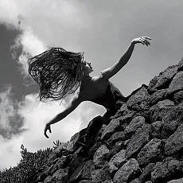<b>Materia</b>2007</li><li><b>Minervae</b>2006</li><li><b>Kiss Me</b>2005</li><li><b>Календарь</b>2004</li><li><b>Nymph</b>2003</li><li>2002<b>Forms</b>2002</li><li>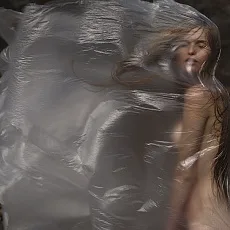<b>Календарь</b>2001</li><li><b>No Time</b>1999</li><li>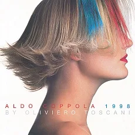<b>Календарь</b>1998</li><li>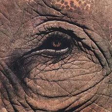<b>Ganesh</b>1997</li><li><b>Diva</b>1996</li><li>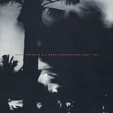<b>Oasis</b>1995</li><li><b>Portraits</b>1994</li><li>1993<b>Water</b>1993</li><li>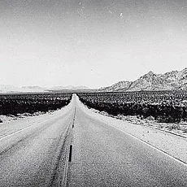<b>Календарь</b>1992</li><li><b>Women</b>1991</li><li>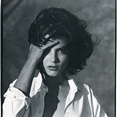<b>Календарь</b>1990</li></ul>

## Ganesh, 1997

Путешествие среди слонов, рек и высоких трав.

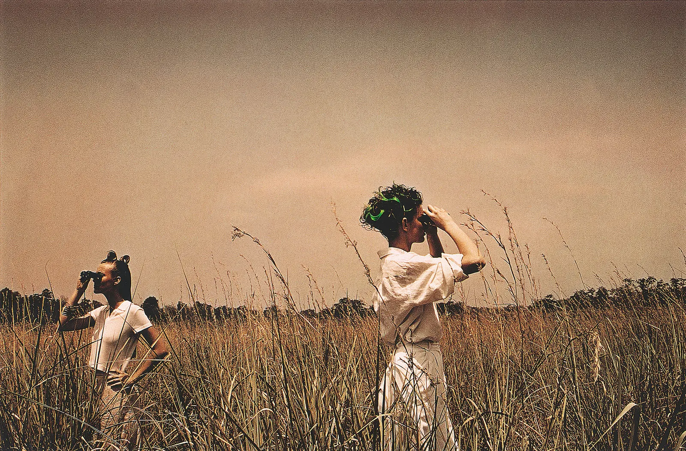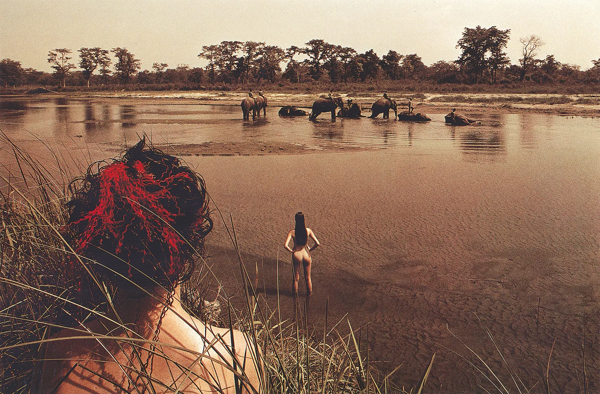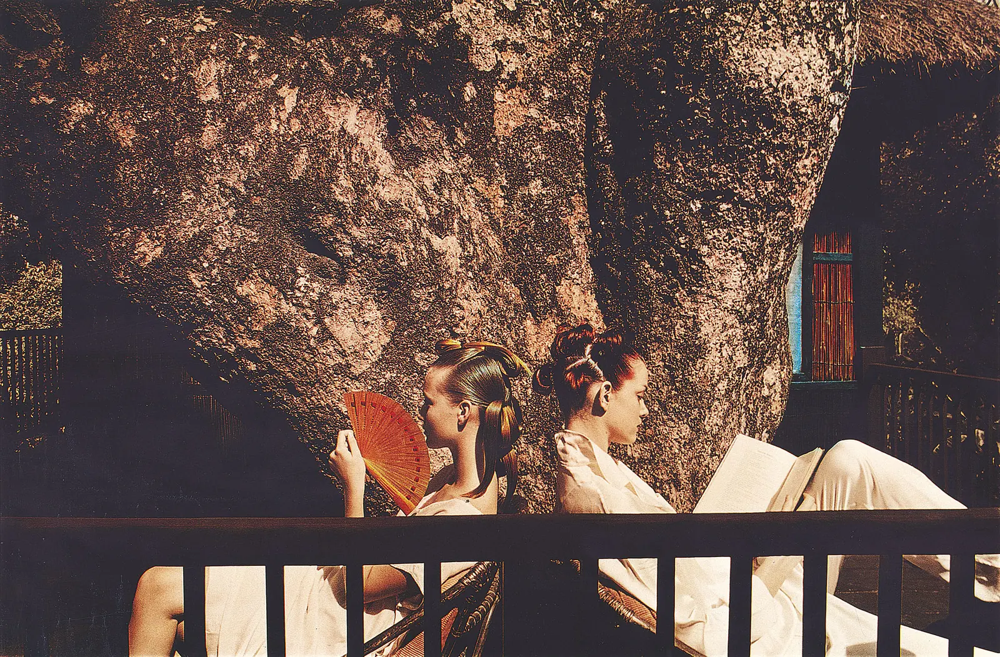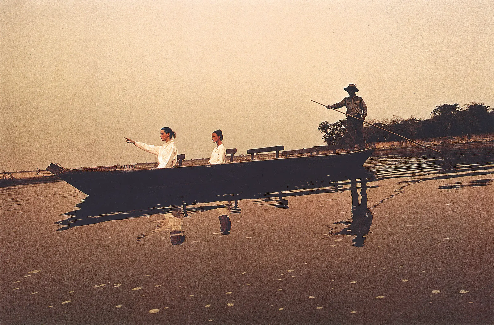

## Nymph, 2003

Нимфы в зелёных садах, с цветами и травами в волосах.

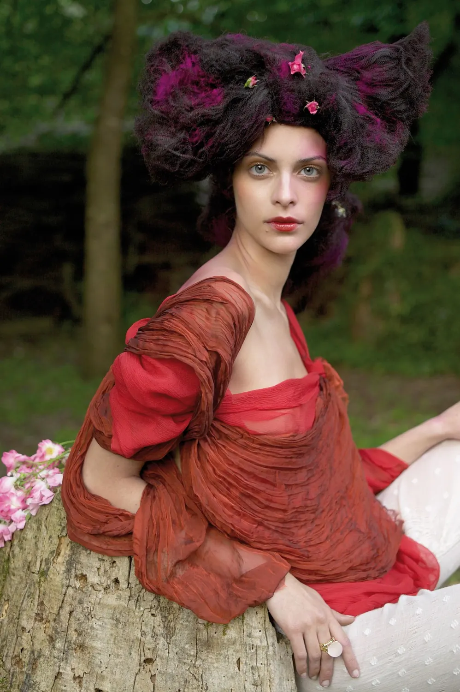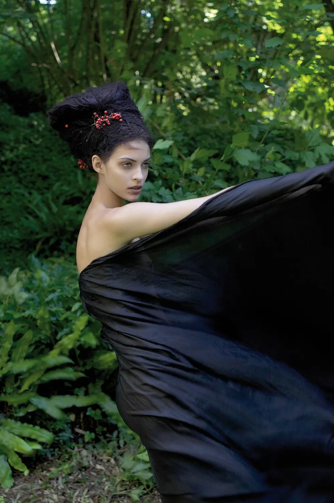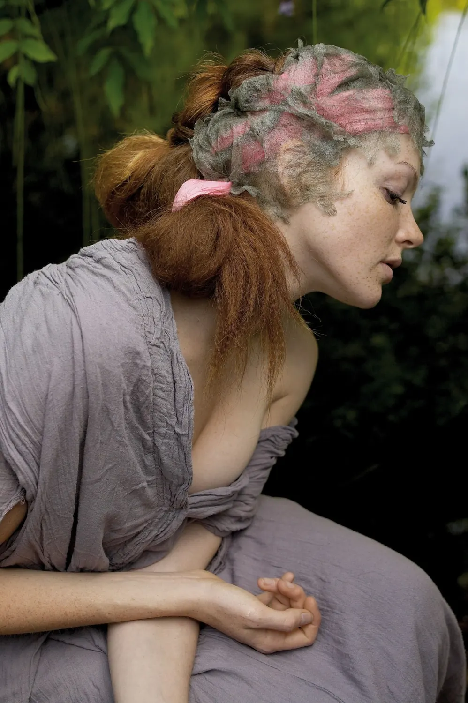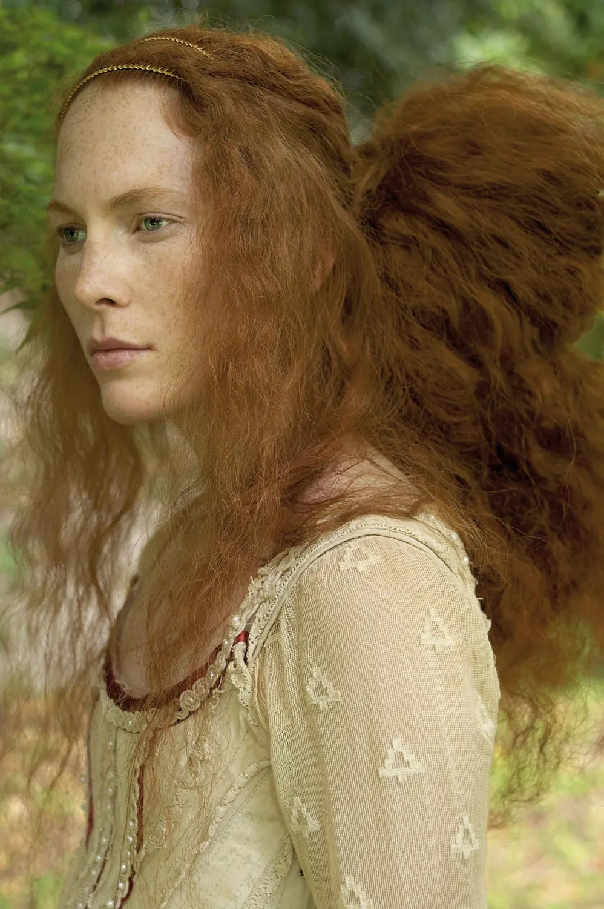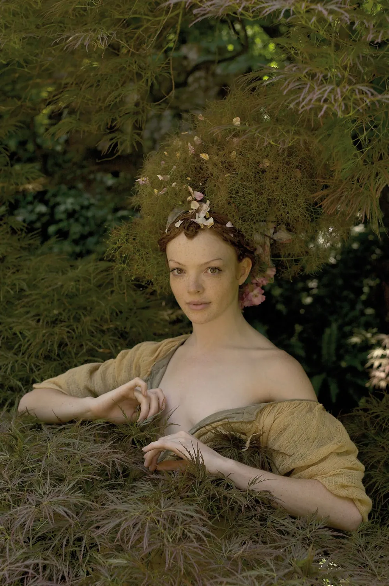

## Читайте также

[История бренда](/o-brende/) · [Aldo Coppola и мода](/stati/moda/aldo-coppola-i-moda/)
