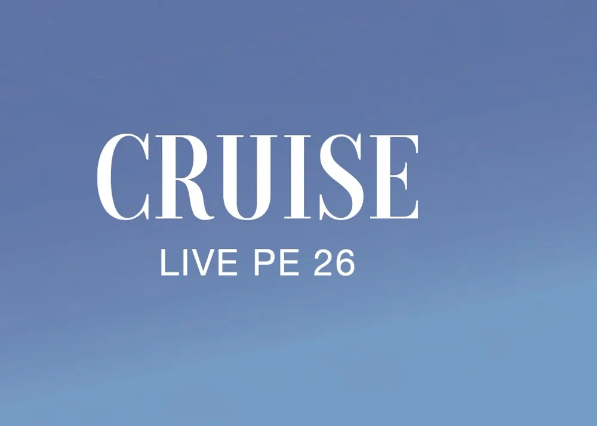
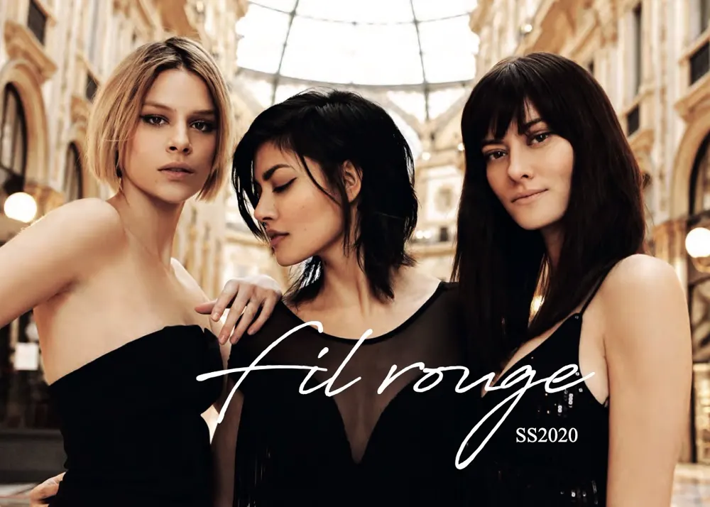
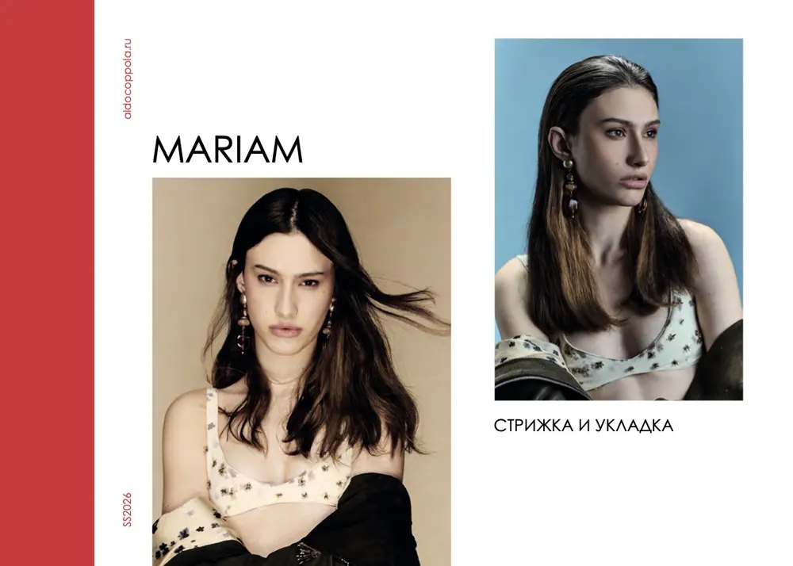
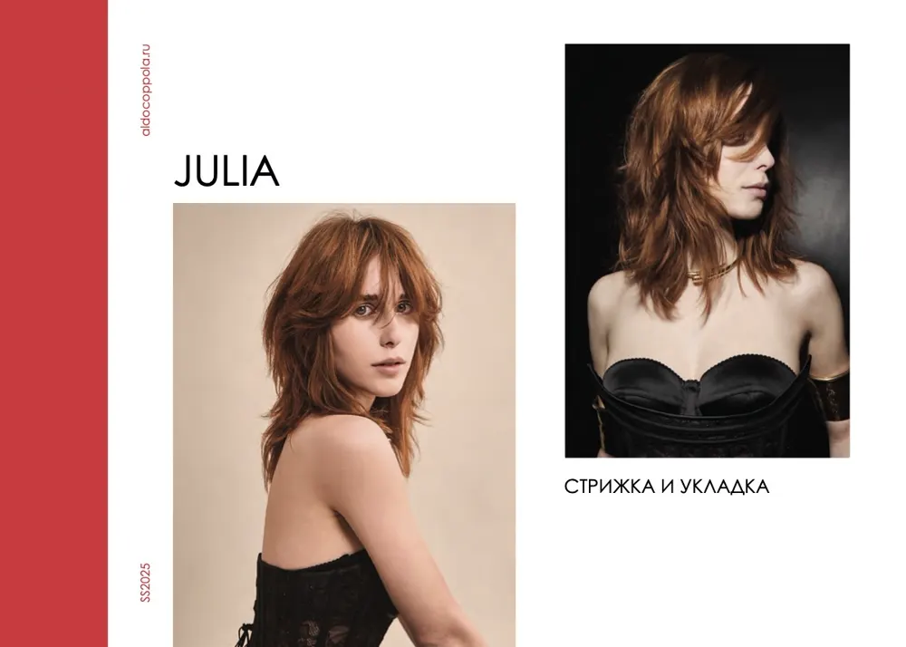
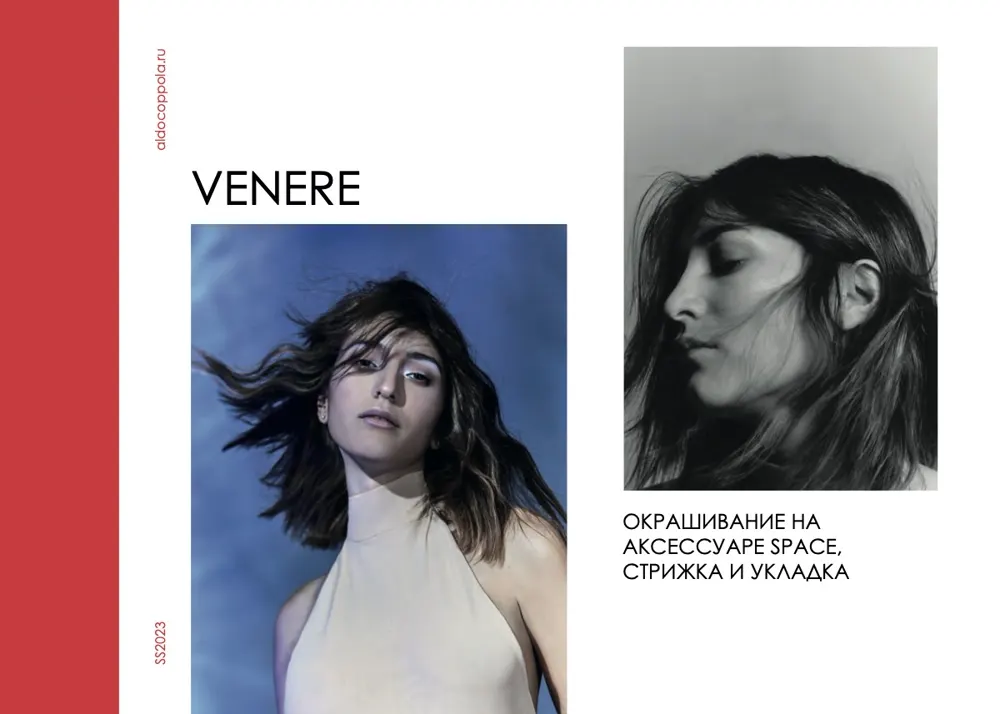

[Скачать PDF · 89 страниц, 13 МБ](/tendencii-2026/aldo-coppola-tendencii-2026.pdf){.btn}

Увидеть новые техники и обучиться им в Милан приезжают стилисты и колористы со всего мира. После каждого шоу стилисты Aldo Coppola привозят техники в Москву, и меню услуг салонов обновляется.

## Style guide Live Show SS19–SS26

## Попробовать в салоне

[Женская стрижка](/uslugi/volosy/zhenskaya-strizhka/) · [Шатуш](/uslugi/volosy/okrashivanie-shatush/) · [Укладка](/uslugi/volosy/ukladka/) · [Обучение в Академии](/akademiya/)
